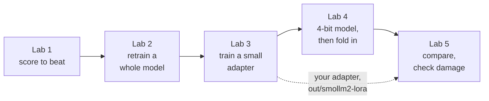
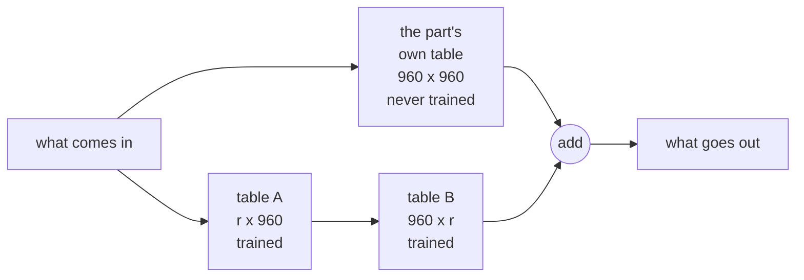
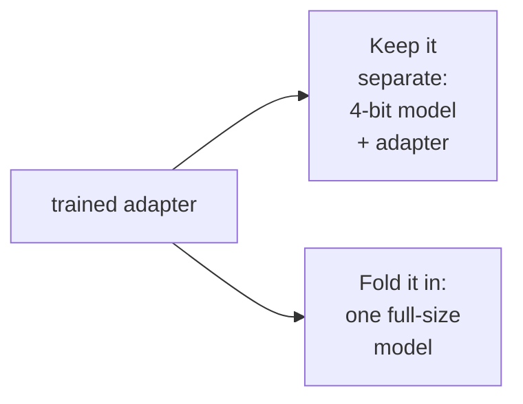

# Fine-Tuning Small AI Models: LoRA, QLoRA & Evaluation

## Revision 1.19 - 11/13/26

**Workshop labs**

Five labs, about 10 minutes each, on one task: turning a support ticket into
one strict line. Each lab saves its files in `out/`, and its scores in
`out/results.json` for Lab 5 to compare:



A list of every file in `out/` is at the end of the labs.

**Merging code.** Each lab opens a side-by-side view: the finished code on the
left, your file on the right. Click the arrow (`→`) beside each highlighted
block to copy it across, top to bottom, until nothing is highlighted. Save
(`Cmd+S` on Mac, `Ctrl+S` elsewhere) and close the tab. Hover over a block to
read what it does.


**New words?** A one-page glossary is at the end of this document.

<br><br>

---

## **Lab 1 - The Task and the Score to Beat**

**Purpose: Measure the best an untrained model can do. Every later lab has to
beat it.**

**Time: 10 minutes**

<br><br>

**The task.** Northwind Logistics wants each support ticket turned into one line:

```
category: access-management | priority: P2 | queue: identity-team
```

8 categories, 4 priorities, 6 queues: a labeling scheme no model has seen.

<br><br>

1. In a terminal at `/workspaces/fine-tuning`, open your starter file next to
the finished one, and merge the three highlighted blocks: how a model is
asked a question, how the best prompt is built, and how answers are scored.

```
code -d extra/lab1_prep_complete.txt finetune/lab1_prep.py
```

<br><br>

2. **Guess first:** with the best prompt, how many of the 20 test tickets will
SmolLM2 put in the right category? Random guessing gets 2 or 3. Then run it
(about 2 minutes):

```
python finetune/lab1_prep.py
```

It tries two untrained models: distilgpt2 with just the ticket, then SmolLM2
(the model Labs 3 and 4 train) with the best prompt we could write. It also
writes two files for you to look at while it runs.

<br><br>

3. When the first terminal prints **Wrote two files**, open a second terminal
(click the **+** at the top right of the terminal panel) and look at the best
prompt:

```
cat out/lab1_best_prompt.txt
```

If `cat` says *No such file or directory*, the file is not written yet: wait a
few seconds and run it again. The same goes for every file the labs write.

*Optional:* to open it in an editor tab instead, run
`code out/lab1_best_prompt.txt`.

Find the rules, the list of labels, and the 8 sample tickets, each
followed by its correct answer. Notice how long it is: it is sent with every
ticket.

<br><br>

4. In the second terminal, look at the answers so far. Run it again in a
minute to see more.

```
cat out/lab1_answers.txt
```

*Optional:* to open it in an editor tab instead, run
`code out/lab1_answers.txt`.
The tab updates as the file fills in.

Each ticket shows its correct answer, then what each model wrote back. What
does distilgpt2 write instead of a label? Which part does SmolLM2 get wrong
most often?


<br><br>

5. Back in the first terminal, read **RESULTS**:


- **just ticket: 0%.** distilgpt2 only continues text; it never names a category.
- **best prompt** gets the format right, but still misses most categories
(each 5% is one ticket: was your guess close?).
**This column is the score every later lab has to beat.**
- **priority 45%** looks good, but the model answers P3 for almost every
ticket, and 9 of the 20 test tickets are P3.

<br><br>

6. **Think about it:** the best prompt is long, and you pay for it on every
request. Training puts that knowledge into the model instead, if it can beat
this score.

<br><br>

**Optional (outside the 10 minutes):** set `N_EVAL = 40` in
`finetune/lab1_prep.py` and rerun for a more reliable score. Set it back to
`20` and rerun before Lab 2.

<p align="center">**[END OF LAB]**</p></br></br>

---

## **Lab 2 - Full Fine-Tuning: Retrain the Whole Model**

**Purpose: Retrain every number in a small model, and see what it costs in
time and disk space.**

**Time: 10 minutes**

<br><br>

**The idea.** Training repeats one exercise many times: the model reads a
ticket, guesses the answer one word at a time, and its guess is compared with
the correct answer. Then its numbers are nudged a little toward the right
answer; the further off it was, the bigger the nudge. Here all 82 million
numbers of distilgpt2, the model that scored 0% in Lab 1, get nudged.

<br><br>

1. Merge the three highlighted blocks: how each ticket and its correct answer
become one training example, the training settings (how long and how fast),
and handing everything to the Trainer, Hugging Face's ready-made training
tool.

```
code -d extra/lab2_fullft_complete.txt finetune/lab2_fullft.py
```

<br><br>

2. **Guess first:** distilgpt2 got no categories right in Lab 1. After about
2½ minutes of training, will it beat the best prompt's 30%? Then run it
(about 3 minutes):

```
python finetune/lab2_fullft.py
```

While it runs: **STEP 1** says **100%** of the model will be trained. Then
watch the **loss**, how wrong the model's guesses are, fall as it trains. It
prints every 3 steps, and every 18 steps it also shows the model's answer to
one test ticket at that moment.
Before training it just writes more ticket-like text. Watch it learn the
format, then the labels. Which part keeps changing?

<br><br>

3. When the first terminal prints **Wrote out/lab2_examples.txt** (just
before training starts), look at exactly what it trains on, in your second
terminal:

```
cat out/lab2_examples.txt
```

*Optional:* to open it in an editor tab instead, run
`code out/lab2_examples.txt`.

Each example is the prompt, then the correct answer, then the end-of-text
marker (`<|endoftext|>`) that teaches it where to stop. In this lab the model
is graded on every word, the ticket included. Lab 3 changes that.


<br><br>

4. Still training? Look at training data other people share. Open this
Hugging Face dataset in a browser tab (no account needed):

[huggingface.co/datasets/Tobi-Bueck/customer-support-tickets](https://huggingface.co/datasets/Tobi-Bueck/customer-support-tickets)


It holds about 62,000 support tickets (some in German), each with a subject,
the text, a reply, and labels such as **type**, **queue** and **priority**:
the same kind of job as ours. Click a few rows to read them, then compare:

- **Labels:** which are like ours, and which are new?
- **Size:** we train on 281 tickets, and our model still answers P3 for almost
every priority. What might thousands more examples change?
- **License:** the tag near the top says `cc-by-nc-4.0`: free to use, but not
to sell. Check this before you train on anyone's data.

*Optional:* [databricks-dolly-15k](https://huggingface.co/datasets/databricks/databricks-dolly-15k)
is a different job: 15,000 instructions, each with a person's answer.
[Kaggle](https://www.kaggle.com/datasets) shares datasets too (a free account
is needed to download).

<br><br>

5. Back in the first terminal, read the line after training: how long it took,
and the size of the saved model. Retraining everything saves a whole new copy, one per customer or task.

<br><br>

6. Read **RESULTS**:


Was your guess right? A model 4 times smaller, after a few minutes of
training, beats the best prompt on category and queue. Priority stays at 45%: it still answers P3 for
almost everything.

<br><br>

**Optional (outside the 10 minutes):** change `num_train_epochs=2` to `1`
(one pass over the data) and rerun. Change one thing at a time, so you know
what made the difference. Set it back and rerun before Lab 5.

**Optional:** to see the loss for every single step, rerun with
`python finetune/lab2_fullft.py --loss-every 1`. Each number then comes from
one batch of 8 tickets, so it jumps around more than the default, which is the
average of 3 steps. Printing more often does not change the training.

<p align="center">**[END OF LAB]**</p></br></br>

---

## **Lab 3 - LoRA: Train a Small Add-On Instead**

**Purpose: Train only about 2% of a model 4 times bigger than Lab 2's, and save
a small add-on file instead of a whole copy.**

**Time: 10 minutes**

<br><br>

**The idea.** LoRA leaves the model unchanged and trains a small add-on beside
it, called an *adapter*.

<br><br>

1. Merge the three highlighted blocks: the LoRA settings (how big the adapters
are, and which parts of the model get one), adding the adapters to the model,
and grading only the answer.

```
code -d extra/lab3_lora_complete.txt finetune/lab3_lora.py
```

<br><br>

2. **Pick your adapter size.** In `finetune/lab3_lora.py`, find `r=16` in the
first block you merged. Keep it, or change both numbers to another row, then
save:

| Adapter | Size | How strongly it counts |
|---|---|---|
| small | `r=4` | `lora_alpha=8` |
| as given | `r=16` | `lora_alpha=32` |
| big | `r=64` | `lora_alpha=128` |


<br><br>

3. **Guess first:** at `r=16` the saved adapter is about 37 MB. How big will
yours be? Will it score better or worse? Then run it (about 3½ minutes):

```
python finetune/lab3_lora.py
```

While it runs: **STEP 1** says how much of the model will be trained (about
**2%** at `r=16`; Lab 2: 100%), and that only the answer is graded now. The
loss prints every step, rising a little at times because each step trains on
different tickets. Every 6 steps it shows its answer to test ticket 1.

<br><br>

4. When the first terminal prints **Wrote out/lab3_examples.txt** (the end of
STEP 1, after the model loads), look at the same kind of training examples as
in Lab 2, now split into the part that is graded and the part that is not:

```
cat out/lab3_examples.txt
```

*Optional:* to open it in an editor tab instead, run
`code out/lab3_examples.txt`.

The ticket is still given to the model, but only the answer is graded. That is
the third block you merged. (SmolLM2's end-of-text marker is `<|im_end|>`.)


<br><br>

5. Still training? Look at what is being trained, in your second terminal:

```
cat out/lab3_adapter.txt
```

*Optional:* to open it in an editor tab instead, run
`code out/lab3_adapter.txt`.

Every part with an adapter now works like this:



Find your `r` in the sizes of tables A and B. Table B starts as all zeros, so
before training the adapter changes nothing. Lab 4 looks at it again, trained.


<br><br>

6. Back in the first terminal, read the line after training: your adapter's
size. Was your guess close? A full copy would be about 1,400 MB.

*Optional:* `ls -lh out/smollm2-lora` lists what was saved:
`adapter_model.safetensors` is the adapter, and `adapter_config.json` names
the one model it fits.


<br><br>

7. When it starts answering the test tickets, look at the answers in your
second terminal. Run it again to see more.

```
cat out/lab3_answers.txt
```

*Optional:* to open it in an editor tab instead, run
`code out/lab3_answers.txt`.
The tab updates as the file fills in.

Each ticket shows its correct answer, then what Lab 1 (the best prompt),
Lab 2 and Lab 3 wrote back. Which tickets did Lab 3 fix? Which part does every
model still get wrong?


<br><br>

8. Back in the first terminal, read **RESULTS**:


Lab 3 beats Lab 2 and the best prompt on category. (The model changed too, so
this is the workshop's progress, not LoRA's alone.)

In a live class, post your size, MB and category score in the chat. Scores
vary a few points from run to run: which sizes beat that, and which fell
behind? Lab 5 uses the adapter you just trained.

<br><br>

**Optional:** rerun with `python finetune/lab3_lora.py --loss-every 6`. You get
4 smoother loss numbers, each the average of 6 steps: the ups and downs are
hidden, not gone. Printing less often does not change the training, though
Lab 3's scores can vary a little from run to run.

<p align="center">**[END OF LAB]**</p></br></br>

---

## **Lab 4 - QLoRA: Train on a 4-Bit Model, Then Fold It In**

**Purpose: Store the model at half a byte per number to save memory, train an
adapter on top, then fold everything into one model to ship. Then try your
Lab 3 model on tickets you write.**

**Time: 10 minutes**

<br><br>

**Before you run it:** on a CPU, 4-bit training is slow, so this lab trains
only 3 steps: enough to see it work, not to score it. **QLoRA saves memory,
not time.**

<br><br>

1. Merge the three highlighted blocks: the 4-bit settings, loading the model
with them, and folding the trained adapter into a full-size copy of the model.

```
code -d extra/lab4_qlora_complete.txt finetune/lab4_qlora.py
```

<br><br>

2. **Guess first:** Lab 3 trained at under 1 second per example. At 4 bits,
is it 2 times slower, 5 times, or 30 times? Then run it (about 3 minutes):

```
python finetune/lab4_qlora.py
```

<br><br>

3. Read **STEP 1**: the same model in memory at 32 bits and at 4 bits, and how
much a model 3 times bigger would need at 4 bits. Less than Lab 3's model at
32 bits.

<br><br>

4. When the first terminal prints **Wrote out/lab4_numbers.txt** (the end of
STEP 1), look at what 4 bits does to the model's numbers while STEP 2 trains,
in your second terminal:

```
cat out/lab4_numbers.txt
```

*Optional:* to open it in an editor tab instead, run
`code out/lab4_numbers.txt`.

Each number comes back rounded, and small ones often become exactly 0.


<br><br>

5. Still training? Look inside your Lab 3 adapter, now trained:

```
python tools/look_inside.py
```

Table B is no longer all zeros. Which layers changed most, and by how much?


<br><br>

6. Back in the first terminal, read **STEP 2**: the loss still falls, so
training works on the 4-bit model. Then the time per example, compared with
Lab 3. Was your guess close? Use QLoRA when memory is the problem.

<br><br>

7. Read **STEP 3**: the adapter folded into one ordinary model, then the
memory each way of shipping it needs:



Fold it in for one dedicated use; keep adapters separate to share one model
across many customers. Lab 5 checks that folding in does not change the
answers.


<br><br>

8. **Your turn: try to fool it.** When Lab 4 has finished, ask your Lab 3
model about tickets you write (about 15 seconds per ticket):

```
python tools/ask.py
```

Type a ticket and press Enter (an empty line stops). You get the original
model's answer with Lab 1's best prompt, then your trained model's, each with
how sure it is of the category. Try an easy one, then try to fool it: two
problems in one ticket, slang, or another language. In a live class, post the
best one that fooled it.


<br><br>

**Optional:** compare Lab 3's adapter (24 training steps) with Lab 4's
(3 steps): `python tools/look_inside.py out/smollm2-lora out/smollm2-qlora`

**Optional, at home:** a fair quality test: set `QLORA_STEPS = 24` and
`QLORA_BATCH = 8` (about 70 minutes on a CPU, minutes on a GPU).

<p align="center">**[END OF LAB]**</p></br></br>

---

## **Lab 5 - Compare Everything, and Check for Damage**

**Purpose: Put every run side by side, see where the best model fails, and
check that training didn't make it worse at everything else.**

**Time: 10 minutes**

<br><br>

**The idea.** One overall score can hide problems. A model can do well on
most tickets and badly on one kind, or learn your task and get worse at
everything else. This lab looks for both.

<br><br>

1. Merge the four highlighted blocks: attaching your Lab 3 adapter to the
original model, counting right answers for each category, switching the
adapter off to quiz the original model, and folding the adapter into the
model.

```
code -d extra/lab5_eval_complete.txt finetune/lab5_eval.py
```

<br><br>

2. **Guess first:** in STEP 4 the adapter is folded into the model. How many
of the 20 answers will change? Then run it (about 3 minutes):

```
python finetune/lab5_eval.py
```

<br><br>

3. Read **STEP 1**, every run side by side. Compare each trained run with the
**best prompt** row, and read the MB column: what you would ship. To see those
sizes on disk, in your second terminal:

```
du -sh out/*/
```


<br><br>

4. When **STEP 2** prints **Writing out/lab5_mistakes.txt** (after it loads
the Lab 3 model), look at every ticket it gets at least partly wrong, in your
second terminal, while it answers. Run it
again to see more.

```
cat out/lab5_mistakes.txt
```

*Optional:* to open it in an editor tab instead, run
`code out/lab5_mistakes.txt`.
The tab updates as the file fills in.

Which part is wrong most often? Did your own tickets in Lab 4 trip on the
same thing?


<br><br>

5. Back in the first terminal, read **STEP 2**: right answers for each
category, and the most common mix-up. An overall score says *if* there is a
problem; this says *where*. The usual fix: more training examples of the weak
category.

<br><br>

6. Read **STEP 3**: a 20-question general-science quiz, before and after
training. The block you merged quizzes the same model twice: first with the
adapter switched off (the original model), then with it on. Small changes are
luck. A **big drop** would mean training damaged the model's other skills.

<br><br>

7. Read **STEP 4**: the same 20 tickets, answered with the adapter kept
separate and then folded in (the last block you merged). Was your guess
right? The answers match: folding in changes how the model is packaged, not what it answers. Folded in
is a little faster, but it is one big model, and the adapter can no longer be
switched off or swapped. Which would you pick for one customer? For fifty?


<br><br>

8. **Think about it:** which model would you put into production for
Northwind, and which two numbers from today support it?

<br><br>

**Optional (outside the 10 minutes): compare with a big hosted model.**
**STEP 5** sends the same tickets to a very large model hosted by Groq, with the
best prompt. It needs a free key: follow "Optional: a free Groq API key" in
`README.md`, then rerun. If a hosted model wins, you may not need to fine-tune.
Check that first.

<p align="center">**[END OF LAB]**</p></br></br>

---

## What's in `out/`

Everything the labs save, in the order it is written. Delete the folder to
start over.

| File or folder | Written by | What it is | Used by |
|---|---|---|---|
| `lab1_best_prompt.txt` | Lab 1 | The whole best prompt for one ticket: rules, labels, 8 sample tickets with their correct answers | |
| `lab1_answers.txt` | Lab 1 | Each test ticket, its correct answer, and both untrained models' answers, ✓ right / ✗ wrong | |
| `results.json` | Labs 1-4 | Every run's scores, sizes, times and answers | Lab 3's answers file, Lab 5's table |
| `lab2_examples.txt` | Lab 2 | 3 training examples, exactly as the model trains on them | |
| `distilgpt2-fullft/` | Lab 2 | The whole retrained model: a full copy | |
| `lab3_examples.txt` | Lab 3 | The same examples, split into the graded and not-graded parts | |
| `lab3_adapter.txt` | Lab 3 | One part of the model: its own table, and the adapter's two tables, before training | |
| `smollm2-lora/` | Lab 3 | Your adapter, its settings, and the tokenizer | Lab 5, `tools/ask.py`, `tools/look_inside.py` |
| `lab3_answers.txt` | Lab 3 | Labs 1, 2 and 3's answers to each test ticket, side by side | |
| `lab4_numbers.txt` | Lab 4 | A few of the model's numbers before and after 4 bits | |
| `smollm2-qlora/` | Lab 4 | The adapter trained on the 4-bit model (3 steps) | `tools/look_inside.py` (optional) |
| `smollm2-qlora-merged/` | Lab 4 | That adapter folded into one full-size model | |
| `lab5_mistakes.txt` | Lab 5 | Every test ticket the Lab 3 model got at least partly wrong | |

<br><br>

---

## Where to go next

- **More and better data.** 281 examples is a demo. Real projects typically use
  1,000-10,000 carefully checked examples — and quality matters more than count.
- **Teaching preferences.** Once a model gets the format right, techniques such
  as DPO and GRPO (both in Hugging Face's TRL library) teach it which of several
  correct answers people prefer.
- **Serving many adapters.** Serving tools such as vLLM and TGI can keep one
  model in memory and swap in a different adapter for each request.
- **Running a merged model elsewhere.** A merged model can be converted for
  tools such as Ollama and `llama.cpp`, or compressed further for fast serving.
- **Using a GPU.** These scripts run unchanged on a GPU: remove `use_cpu=True`
  and they run 50-100x faster on a single consumer graphics card.

<br><br>

---

## Appendix — one-page glossary

Plain-language versions of every training term used today.

| Term | What it means here |
|---|---|
| **Parameter (weight)** | One of the millions of numbers inside a model. Training adjusts them; "82M parameters" means 82 million of them. |
| **Loss** | A single number scoring how wrong the model's predictions are on a batch. Training exists to push it down. |
| **Gradient** | For each parameter, which direction (and how strongly) to nudge it to reduce the loss. |
| **Optimizer** | The code that applies those nudges. Ours, called **Adam**, also keeps two extra numbers for every parameter it trains — one reason retraining a whole model needs so much memory. |
| **Learning rate** | How big each nudge is. Too high: the loss jumps around. Too low: nothing happens. |
| **Batch** | How many examples are processed together for one update. |
| **Step** | One round of adjusting the model's numbers (after one batch). |
| **Epoch** | One full pass over the training data. 281 examples at batch 8 ≈ 35 steps per epoch. |
| **Token** | The unit models read — roughly a word fragment. Our tickets are ~50-70 tokens. |
| **Tokenizer** | The tool that turns text into tokens (and back), and adds a chat model's special markers. |
| **End-of-text / padding token** | The end-of-text token is the stop signal the model must learn. The padding token is filler that makes a group of examples the same length. They must be *different* tokens (a comment in Lab 2's code explains why). |
| **Masking / -100** | Marking positions with -100 so they aren't graded — used so the model is graded only on its answer, not on repeating the ticket. |
| **Base vs. instruct model** | A base model only continues text. An instruct model had a further training pass to follow instructions. distilgpt2 is base; SmolLM2-360M-Instruct is instruct. |
| **Rank (r)** | The size of a LoRA adapter. Bigger can learn more, but is bigger and slower to train. |
| **Alpha (lora_alpha)** | How strongly the adapter's adjustments count. The usual setting is twice r. |
| **Adapter** | The small add-on LoRA trains (tens of MB), saved separately from the unchanged model. |
| **Quantization / nf4** | Storing a model's numbers in fewer bits to save memory. "nf4" is the 4-bit format QLoRA uses. |
| **Merge** | Folding an adapter into the model itself to get one ordinary model. Always merge into a full-size (16- or 32-bit) copy. |
| **Test set** | Tickets the model never trained on. The only scores that count. |
| **Baseline** | The best score you can get without training — what every later run is measured against. Ours is the Lab 1 best-prompt score. |
| **Catastrophic forgetting** | Training hard on a narrow task degrading everything else the model could do. Lab 5's general-knowledge quiz (STEP 3) is the check. |

<br><br>

---

<p align="center">
<b>For educational use only by the attendees of our workshops.</b>
</p>
<p align="center">
<b>(c) 2026 Tech Skills Transformations and Brent C. Laster. All rights reserved.</b>
</p>
